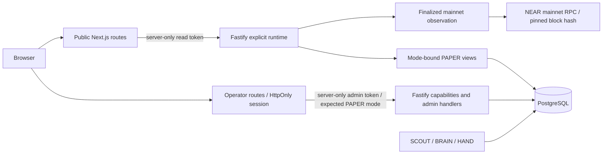

# Architecture

The browser uses same-origin Next.js routes. Next authenticates fixed requests to the separate Fastify backend, which owns PostgreSQL, the durable agent workers, provider keys, signing and accounting.

## Publication contracts

`packages/shared/src/viewer-contract.ts` preserves the original strict v1 snapshot/proof contract. `viewer-details-contract.ts` adds status, paginated cycle details and event metadata. These PAPER endpoints reject LIVE/REPLAY even with valid credentials. `mainnet-contract.ts` separately validates explicit runtime, finalized mainnet snapshots, public wallet balances and known deployment receipts. All are synchronized from reviewed backend source using `scripts/sync-viewer-contract.mjs`.

The deployment provider chooses the mode before rendering telemetry. LIVE starts no PAPER polling or event stream. It polls finalized mainnet state every 20 seconds, slows in a hidden tab and preserves explicit stale/disconnected states. Public wallet connection uses pinned Meteor/MyNearWallet executors and requests no key grant or transaction. It is not operator authentication.

Cycle views publish selected proposal fields, quote arithmetic, phase names, sanitized job error codes, accounting summaries and proof hashes. They exclude raw decisions, model prompts, private event payloads, signing bytes and accounting references. Profit admission diagnostics compare the recorded quote with the **current policy**; they are not a historical policy attestation or realized P&L.

Application compute allowance is published without its internal budget ID. Provider balance remains explicitly unknown when that allowance is the only spending control. The model/measurement fields report configuration, not a fresh attestation. Runway stays null.

## PAPER refresh and replay

The shared provider reads a snapshot every ten seconds, slowing to sixty seconds in a hidden tab. Requests abort on unmount or refresh. Failure marks retained data stale; an initial failure shows a disconnected empty state. Optional status failure does not prevent the main snapshot from loading.

An EventSource connection to `/api/swarm/events` carries sanitized durable event metadata. Next polls the backend's curated event endpoint, deduplicates ascending integer sequence numbers and emits SSE IDs. Native reconnects resume through `Last-Event-ID`. A stream lasts at most a bounded function window, then reconnects; event notification coalesces snapshot refreshes. Polling remains available when streaming fails. Backend bearer credentials never enter the browser's event URL or frames.

## Operator boundary

Operator routes require a signed 30-minute HttpOnly cookie. The access code is a separate server secret from both backend bearer tokens. Cookies use SameSite=Strict; production adds Secure and the `__Host-` prefix. Logout clears the session, and rotating the access code invalidates existing signatures. The application does not persist credentials in browser storage.

Mutations require the browser Origin to match the HTTP request authority, JSON bodies within 16 KiB and an enumerated, strict operation schema. The server constructs fixed backend paths. It checks administrative capability and PAPER mode before dispatch. The backend separately validates `x-symbio-expected-mode: PAPER` before executing an admin handler, preventing a capability-check/deployment race from turning a PAPER request into a LIVE action.

Supported actions are simulated funding, idempotent cycle creation, treasury/lane pause and resume, revision-bound policy changes, a targeted one-shot PAPER worker crash and immutable settlement-bound cost approval. Uncertain funding/cycle responses retain the same request identity for explicit retry. Buttons remain disabled while an operation is pending. Evidence download requires the same operator session and mode gate; it is not a public viewer feature.

Mainnet wallet connection is read-only. Mainnet funding, LIVE arming, compute purchasing and new recovery signers are not supplied by this interface. The runtime stays disarmed even though the owner has unpaused the contract and enabled bounded worker permissions. Contract permission is independent of application arming.

## Hosting and rollback

The existing teammate-owned Vercel project continues serving `https://symbiochain.vercel.app`, with Node 22, `apps/web` and workspace access. The backend remains on Render with Node 24. Browser-to-backend CORS changes are unnecessary.

For a PAPER-only frontend rollback, first restore the compatible PAPER backend environment/image. Keep execution disarmed during transition; an old backend image cannot run in the LIVE/disarmed profile. The mainnet reader needs no database migration; the previously added business migration is additive. Withdrawing frontend access means rotating/removing its server credentials. No owner recovery key is loaded by Render or Vercel.
